# BombLab 实验报告：让城市拥有明天

*从**明天**起，做一个幸福的人*
*喂马、劈柴，周游世界*
*从**明天**起，关心粮食和蔬菜*
*我有一所房子，面朝大海，春暖花开*
*从**明天**起，和每一个亲人通信*
*告诉他们我的幸福*
*那幸福的闪电告诉我的*
*我将告诉每一个人*
*给每一条河每一座山取一个温暖的名字*
*陌生人，我也为你祝福*
*愿你有一个灿烂的前程*
*愿你有情人终成眷属*
*愿你在尘世获得幸福*
*我只愿**面朝大海，春暖花开***
*（海子，1989）*

## 摘要

本实验以个人 BombLab 可执行文件为分析对象，通过阅读 x86-64 汇编和静态数据，恢复六个常规关卡及隐藏关的输入约束与计算过程，并在 `defuser.c` 中实现随 `challenge` 变化的通用求解器。分析依次涉及函数调用、数组递推、跳转表、递归、链表和函数指针；隐藏关进一步要求将字节布局与依赖前六关答案的上下文校验结合起来。验证采用具体输入的手工计算、公开列表之外的 seed 测试及完整公开测试，最终六关公开测试为 **60/60**，隐藏关为 **10/10**。这些结果支持实现与已恢复逻辑的一致性，通用性仍需由位宽、分支映射和边界分析共同说明。

报告同时梳理“这里还没有明天”的数字城市故事，讨论维护、存档与人物选择之间的联系。技术部分说明怎样从程序中恢复规则，故事部分则记录这些规则被赋予的生活意义。

**关键词：** 反汇编；x86-64；无符号整数；控制流；数据结构；上下文校验

## 实验目的

1. 理解 C 语言结构在机器级代码中的表示，能从寄存器、栈位置和访存偏移恢复参数、局部变量及数据结构。
2. 根据输入解析、计算过程和最终比较建立求解关系，区分某次运行的口令与适用于不同 `challenge` 的计算方法。
3. 准确处理 32 位截断、无符号回绕、逻辑移位、循环移位和小端字节序，避免只在部分输入下成立的翻译。
4. 形成“读取汇编与数据—提出解释—实现—重新编译—多输入验证”的工作流程，并用可复核的指令、示例和截图记录依据。

## 实验环境与实现约定

下表为报告复核时读取的本地环境信息，用于说明运行和复现条件。

| 项目 | 环境或设置 |
| --- | --- |
| 宿主与终端 | Windows；PowerShell 负责文件检查，WSL2 内执行 Linux 工具及实验程序 |
| Linux 发行版 | Ubuntu 26.04 LTS |
| 内核与架构 | `6.18.33.2-microsoft-standard-WSL2`，x86-64 |
| 分析对象 | 个人 `bomb`，ELF 64 位小端可执行文件，动态链接，保留符号信息 |
| C 编译器 | GCC 15.2.0 |
| 反汇编工具 | GNU objdump，Binutils 2.46 |
| 构建与测试运行环境 | GNU Make 4.4.1；Python 3.14.4 |
| 编译设置 | `-I. -std=c11 -O2 -Wall -Wextra -Wpedantic -Werror` |
| 成果文件 | `defuser.c` 保存求解实现；`report.md` 保存报告；截图统一放在 `screenshots/` |

全文汇编采用 AT&T 语法，操作数顺序为“源、目标”。`challenge` 和隐藏关的 `context` 使用 `uint64_t`，口令整数及主要中间计算使用 `uint32_t`。文中的 `^` 表示按位异或，32 位无符号加法和乘法按模 2³² 回绕；右移 `challenge` 后再转为 `uint32_t`，与先截断再右移并不等价。实际运行使用十进制口令，报告中的十六进制表示用于对照寄存器、常量和内存内容。

所有求解逻辑集中在 `defuser.c`，必要时增加辅助函数。求解接口、驱动程序、测试程序、Actions 工作流与个人炸弹均不作为解题修改对象；验证通过程序正常接收输入完成，不通过修改炸弹内部状态跳过检查。固定表项可以从个人炸弹中恢复并记录，但最终口令必须根据传入参数计算。

## 分析方法与关卡概览

每关先确定输入字段数量和成功条件，再追踪 `challenge` 如何进入计算。遇到间接跳转、间接调用或指针访问时，结合静态数据恢复真实目标；得到计算式后，先对照一个具体输入，再实现通用求解器。源码保存后重新执行 `make`，随后进行单关、多个 seed 和公开测试验证。

报告保留决定结论的关键指令，省略不影响计算关系的函数序言、对齐指令和重复退出路径。下表概括各关分析重点；后文分别展开推导与证据。

| 关卡 | 口令数量 | 核心计算结构 |
| --- | --- | --- |
| Phase 1 | 1 个整数 | 拆分 challenge，依次调用辅助函数并合并返回值 |
| Phase 2 | 6 个整数 | 计算首项，再按下标递推后五项 |
| Phase 3 | 2 个整数 | 计算索引，通过跳转表选择对应分支 |
| Phase 4 | 1 个整数 | 二分递归查找目标，返回时逐层组合结果 |
| Phase 5 | 2 个整数 | 从指定节点沿链表遍历，计算累积值并记录末节点标识 |
| Phase 6 | 1 个整数 | 从函数指针表选择两次操作，依次组合返回值 |
| Secret phase | 32 字节填充、OPEN、3 个整数 | 构造指定字节布局，再结合 challenge 和前六关答案的 context 计算口令 |

## 背景故事概述：这里还没有明天

故事从实验室的一个普通夜晚开始。“你”和林夏接上一台旧设备，进入一座由 AI 居住的数字城市。街边的维修铺还在忙碌，维护站的终端留着 sky 的问候。维护面板上的炸弹图标对应六项尚未完成的交接检查，两人由此开始沿着旧系统留下的记录排查问题。

最初的异常藏在日常细节里：钟楼的齿轮照常转动，城市却总停在同一天；送货司机反复承诺明天送达，维修铺的灯也迟迟不能装好。两人从维护站进入钟楼，再追踪请求到分流站和档案馆。直到找回迁移记录，原因才逐渐清楚：新设备接入时交接没有完成，城市每到夜里便恢复最后一份旧存档，居民当天完成的事情因此无法保留下来。

随后，两人沿巡检回廊核对设备连接，最终在交接室完成检查。终端显示“保存完成”，日期向前走了一天。这一次，今天的变化被留下了。司机开始安排新的送货行程，维修铺老板也揭下了写着“明天装上”的纸条。

隐藏关位于观测台，保存着署名 sky 和许遥的旧备份。城市已恢复正常，是否继续阅读由来访者决定。档案中的留言记录了 sky 去北方尝试新项目、许遥暂时留下的选择，也记录了多年间的雪照、工作变化与零星维护。他们各自生活，谁回来便为城市添一点东西。观测台的灯与两把椅子，留下了让后来者坐一会儿的位置。

离开观测台时，“你”把久藏的项目介绍放进明天待办，林夏也在本子上记下几行。结尾回到实验室，两人确认文件保存，关灯离开。数字城市终于获得的“明天”，也延伸到了屏幕外尚待开始的生活。以上梗概依据个人 `bomb` 内嵌剧情文本整理；后文的赏析为阅读这些文本后形成的个人理解。

## 第 1 关：函数调用、参数传递与返回值

### 1. 输入格式和总体结构

第一关检查一个整数是否等于 `p1_compute(challenge)`。`phase_01` 中决定输入格式和答案判定方式的关键指令如下：

```asm
mov    $0x1,%esi
call   <valid_u32_fields>
...
lea    -0x14(%rbp),%rdx
mov    $0x403182,%esi
mov    %rbx,%rdi
call   <__isoc99_sscanf@plt>
cmp    $0x1,%eax
jne    <phase_01+0x23>
...
mov    %r12,%rdi
call   <p1_compute>
cmp    %eax,-0x14(%rbp)
sete   %al
```

按照 x86-64 System V 调用约定，函数的前两个参数分别通过 `rdi` 和 `rsi` 传递。进入 `phase_01` 时，`rdi` 指向输入字符串，`rsi` 保存本次运行的 `challenge`。程序先把二者分别保存到 `rbx` 和 `r12`。

调用 `valid_u32_fields` 前，`esi` 被设置为 1，说明本关要求恰好输入一个无符号 32 位十进制整数。随后 `sscanf` 把这个整数写到栈上的 `rbp-0x14`，并要求返回值为 1。最后，程序把 `challenge` 作为参数调用 `p1_compute`，将其返回值与输入整数比较。因此，本关需要求出 `p1_compute(challenge)`。

### 2. `p1_compute` 的参数拆分

`p1_compute` 中与 `challenge` 拆分有关的指令为：

```asm
mov    %rdi,%rax
mov    %rdi,%rdx
mov    %edi,%r8d
shr    $0x20,%rax
shr    $0x10,%rdx
mov    %eax,%r9d
mov    %eax,%esi
```

设 `challenge` 为 `c`，则可以定义：

```c
uint32_t lo  = (uint32_t)c;
uint32_t hi  = (uint32_t)(c >> 32);
uint32_t mid = (uint32_t)(c >> 16);
```

其中，`lo` 是 `challenge` 的低 32 位，`hi` 是高 32 位，`mid` 是右移 16 位后截取的低 32 位，即原数的第 16 至 47 位。

### 3. 三个计算步骤

`p1_step0` 的关键指令是：

```asm
lea    (%rdi,%rsi,2),%eax
xor    $0x9809,%eax
```

调用该函数时，`rdi` 保存原始 `challenge`，`rsi` 保存 `hi`。结果写入 `eax`，所以只保留低 32 位。由此得到：

```c
uint32_t a = (lo + 2u * hi) ^ 0x9809u;
```

`p1_step1` 的关键指令是：

```asm
lea    (%rdi,%rdi,4),%eax
add    $0xf369,%esi
xor    %esi,%eax
```

这里 `lea (%rdi,%rdi,4),%eax` 计算 `5 * edi`。调用时 `edi` 为 `hi`，`esi` 为 `mid`，因此：

```c
uint32_t b = (5u * hi) ^ (mid + 0xf369u);
```

`p1_step2` 的关键指令是：

```asm
lea    (%rdi,%rdi,2),%eax
add    %esi,%eax
xor    $0xd128,%eax
```

这里 `lea (%rdi,%rdi,2),%eax` 计算 `3 * edi`。调用时 `edi` 为上一步的结果 `b`，`esi` 为 `lo`，因此：

```c
uint32_t d = (3u * b + lo) ^ 0xd128u;
```

回到 `p1_compute` 后，最后一条关键指令为：

```asm
xor    %ecx,%eax
```

调用 `p1_step1` 前，`mov %eax,%ecx` 保存了第一步的返回值 `a`；后面的两个辅助函数均未改写 `ecx`。因此最终比较前，`ecx` 保存 `a`，`eax` 保存第三步的结果 `d`，答案为：

```c
uint32_t answer = d ^ a;
```

这里的值跨函数保留，是检查各辅助函数指令后得到的结论。`rcx` 等寄存器允许被被调用函数改写，不能仅凭调用约定假设调用后数值不变。`lea` 虽使用 64 位地址寄存器，但结果写入 `eax` 时只保留低 32 位，故上述表达式可以用 `uint32_t` 复现。

下面的数据流图展示了各步的依赖关系；尤其是第一步的结果 `a` 会保留到最后才参与异或：

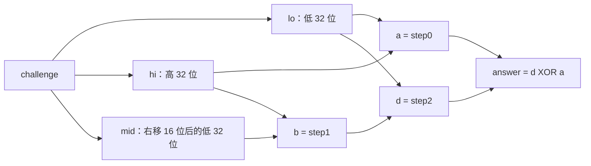

### 4. 恢复出的通用计算关系

综合以上分析，第一关的完整计算关系为：

```c
uint32_t lo = (uint32_t)challenge;
uint32_t hi = (uint32_t)(challenge >> 32);
uint32_t mid = (uint32_t)(challenge >> 16);

uint32_t a = (lo + 2u * hi) ^ 0x9809u;
uint32_t b = (5u * hi) ^ (mid + 0xf369u);
uint32_t d = (3u * b + lo) ^ 0xd128u;
uint32_t answer = d ^ a;
```

求解器把 `answer` 写入 `values[0]`，并将 `count` 设为 1，再由 `write_answer` 输出十进制口令。

### 5. 运行验证

使用公开 seed `42` 时，求解器输出 `1165799899`，并成功解除第一关：

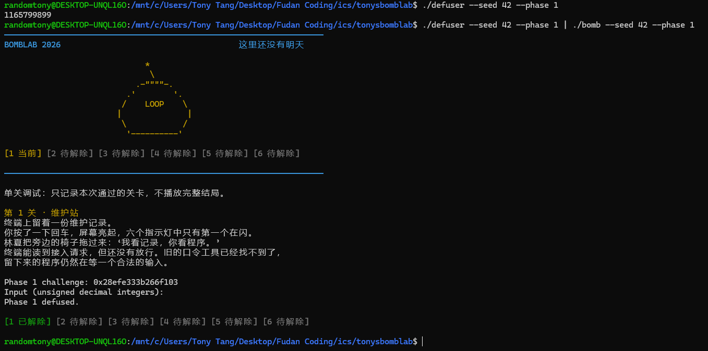

另用不在 `tests/public.json` 公开列表中的 seed `314159` 检验通用求解器，结果如下：

```text
$ ./defuser --seed 314159 --phase 1 | ./bomb --seed 314159 --phase 1
Phase 1 challenge: 0xd85dda4696932a2d
Input (unsigned decimal integers):
Phase 1 defused.
```

对应运行截图如下：

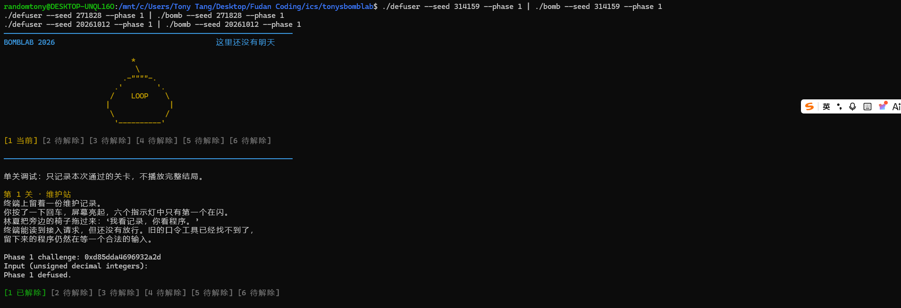

## 第 2 关：数组、循环与递推关系

### 1. 确定输入数量与数组布局

第二关先检查首项，再逐项检查后五个整数是否满足递推关系。反汇编命令为 `objdump -d --no-show-raw-insn --disassemble=phase_02 ./bomb`。入口处将 `challenge` 保存到 `r13`，随后检查输入格式：

```asm
40208a: mov    %rsi,%r13
40208d: mov    $0x6,%esi
40209c: call   <valid_u32_fields>
...
4020de: call   <__isoc99_sscanf@plt>
4020e5: cmp    $0x6,%eax
4020e8: jne    <phase_02+0x25>
```

格式检查的数量参数为 6，且 `sscanf` 必须成功赋值 6 次，因此口令是六个无符号 32 位整数。六个输出地址分别为 `rbp-0x40`、`rbp-0x3c`、`rbp-0x38`、`rbp-0x34`、`rbp-0x30`、`rbp-0x2c`，相邻元素相差 4 字节，可以视为数组 `values[0..5]`。`sscanf` 的字符串和格式串占用前两个参数位置，前四个输出指针通过 `rdx`、`rcx`、`r8`、`r9` 传递，最后两个输出指针通过栈传递。

### 2. 恢复首项

```asm
4020ea: mov    %r13,%rax
4020ed: mov    -0x40(%rbp),%esi
4020f0: shr    $0x1c,%rax
4020f4: add    %eax,%eax
4020f6: movzbl %al,%eax
4020f9: add    $0x11,%eax
4020fc: cmp    %eax,%esi
4020fe: jne    <phase_02+0x25>
```

`0x1c` 为十进制 28。程序将 `challenge` 逻辑右移 28 位，利用 `add %eax,%eax` 将低 32 位乘以 2。`movzbl %al,%eax` 将最低 8 位零扩展到 32 位，相当于与 `0xff` 按位与。最后加上 `0x11`（17），与输入的第一个整数比较。因此首项为：

```c
values[0] = (((uint32_t)(challenge >> 28) * 2u) & 0xffu) + 0x11u;
```

这里截取低 8 位发生在加 17 之前，不能将掩码移到整个表达式的末尾。

### 3. 恢复循环与递推式

首项检查通过后，程序将 `rdx` 设为 1，作为数组下标 `i`：

```asm
402100: mov    $0x1,%edx
402105: lea    (%rdx,%rdx,1),%ecx
402108: mov    %r13,%rax
40210b: shr    %cl,%rax
40210e: lea    0x6(%rdx),%ecx
402111: and    $0x1f,%eax
402114: xor    %ecx,%eax
402116: lea    (%rsi,%rsi,2),%ecx
402119: mov    -0x40(%rbp,%rdx,4),%esi
40211d: add    %ecx,%eax
40211f: cmp    %eax,%esi
402121: jne    <phase_02+0x25>
402123: add    $0x1,%rdx
402127: cmp    $0x6,%rdx
40212b: jne    <phase_02+0x85>
```

第一条 `lea` 计算 `2*i`，随后 `shr %cl,%rax` 按这个位数右移 `challenge`。与 `0x1f` 按位与保留最低 5 位，再与 `i+6` 异或，得到本轮的附加项。

循环开始时，`esi` 保存上一项 `values[i-1]`。`lea (%rsi,%rsi,2),%ecx` 先计算上一项的三倍，然后 `mov -0x40(%rbp,%rdx,4),%esi` 读取当前项 `values[i]`。地址中的比例因子 4 对应每个整数的字节数。程序将上一项的三倍与附加项相加，检查是否等于当前项；任一次比较不等就返回失败。

本轮通过后，`esi` 已保存当前项，正好作为下一轮的上一项。下标递增到 6 时退出，所以循环检查 `i=1,2,3,4,5`，共五项。恢复的递推关系为：

```c
uint32_t part = (uint32_t)((challenge >> (2u * i)) & 0x1fu);
values[i] = 3u * values[i - 1] + (part ^ (i + 6u));
```

异或必须先于最后的加法执行，因此实现中保留括号 `(part ^ (i + 6u))`。

循环中的关键是 `esi` 的含义随指令执行而变化：

| 执行位置 | `esi` 的含义 | 作用 |
| --- | --- | --- |
| 一轮开始 | `values[i-1]` | 为计算期望值提供前一项 |
| 执行 `lea` 后 | 仍为 `values[i-1]` | 前一项的三倍已暂存到 `ecx` |
| 执行数组读取后 | `values[i]` | 与计算出的期望值比较 |
| 本轮检查通过后 | `values[i]` | 成为下一轮的前一项 |

### 4. 通用求解实现

在 `solve_phase_2` 中按顺序计算六项：

```c
values[0] =
    (((uint32_t)(challenge >> 28) * 2u) & 0xffu) + 0x11u;

for (uint32_t i = 1; i < 6; ++i) {
    uint32_t part =
        (uint32_t)((challenge >> (2u * i)) & 0x1fu);
    values[i] =
        3u * values[i - 1] + (part ^ (i + 6u));
}

count = 6;
```

最后由模板中的 `write_answer(out, cap, values, count)` 输出六个以空格分隔的十进制整数。移位前保留 `challenge` 的 64 位类型，数组元素及算术结果使用 `uint32_t`，对应汇编中的运算宽度。首项由 `challenge` 唯一确定，每个后续项由已确定的前一项和当前下标唯一确定，因此该实现逐项满足检查条件；多个 seed 的运行用于检验实现是否正确落实这一推导。

### 5. 运行验证

修改后执行 `make`，编译命令启用了 `-Wall -Wextra -Wpedantic -Werror`，编译成功。

使用 seed `42` 时，`challenge = 0x47526757130f9f52`，首项为 243。后续计算如下：

| 下标 i | 右移后取低 5 位的 part | part XOR (i+6) | 当前项 |
| --- | --- | --- | --- |
| 1 | 20 | 19 | 3 × 243 + 19 = 748 |
| 2 | 21 | 29 | 3 × 748 + 29 = 2273 |
| 3 | 29 | 20 | 3 × 2273 + 20 = 6839 |
| 4 | 31 | 21 | 3 × 6839 + 21 = 20538 |
| 5 | 7 | 12 | 3 × 20538 + 12 = 61626 |

手工输入 `243 748 2273 6839 20538 61626` 后，程序显示 `Phase 2 defused.`：

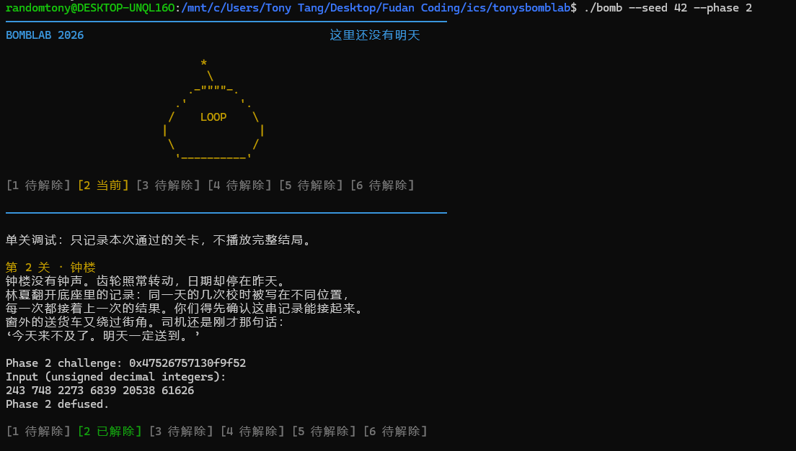

随后使用不在 `tests/public.json` 中的 seed `314159` 验证通用求解器：

```text
$ ./defuser --seed 314159 --phase 2
237 719 2176 6535 19622 58887
$ ./defuser --seed 314159 --phase 2 | ./bomb --seed 314159 --phase 2
Phase 2 challenge: 0x049392bee0cdfbbd
Input (unsigned decimal integers):
Phase 2 defused.
```

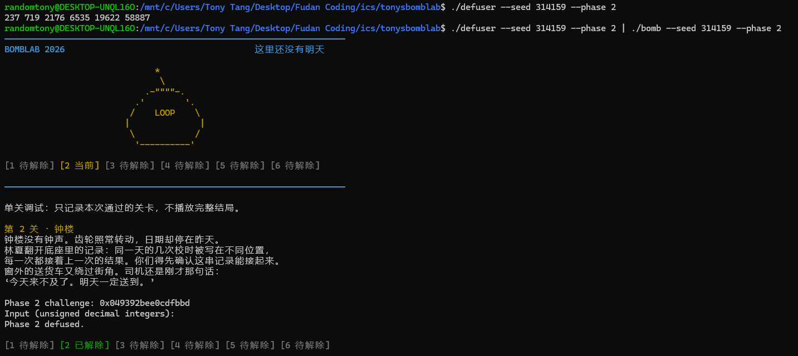

另外运行第二关的公开测试，结果为：

```text
$ python3 public_test.py --phase 2
Phase 2 seed 0: PASS
Phase 2 seed 1: PASS
Phase 2 seed 7: PASS
Phase 2 seed 42: PASS
Phase 2 seed 99: PASS
Phase 2 seed 123: PASS
Phase 2 seed 2026: PASS
Phase 2 seed 65535: PASS
Phase 2 seed 987654321: PASS
Phase 2 seed 18446744073709551615: PASS
Public tests: 10/10
```

## 第 3 关：switch 分支与跳转表

### 1. 确定输入格式与两个整数的含义

第三关要求输入两个无符号 32 位整数。第一个是由 `challenge` 决定的索引，第二个是对应分支的计算结果。关键检查如下：

```asm
40224a: mov    %rsi,%r12
40224d: mov    $0x2,%esi
40225a: call   <valid_u32_fields>
...
402272: lea    -0x14(%rbp),%rcx
402276: lea    -0x18(%rbp),%rdx
402282: call   <__isoc99_sscanf@plt>
402287: cmp    $0x2,%eax
40228a: jne    <phase_03+0x23>
40228c: mov    %r12d,%edi
40228f: xor    %eax,%eax
402291: and    $0x7,%edi
402294: cmp    %edi,-0x18(%rbp)
402297: jne    <phase_03+0x25>
```

`valid_u32_fields` 的数量参数和 `sscanf` 的返回值检查均为 2。两个输入分别存放在 `rbp-0x18` 和 `rbp-0x14`。`r12` 保存 `challenge`，`and $0x7,%edi` 保留其最低三位，故第一个输入必须为：

```c
uint32_t index = (uint32_t)challenge & 7u;
```

如果第一个输入不匹配，程序沿失败路径返回 0。匹配后，程序准备第二个数的计算参数：

```asm
402299: mov    %r12,%rax
40229c: mov    %r12,%rsi
40229f: shr    $0x3,%rax
4022a3: shr    $0x20,%rsi
4022a7: xor    %eax,%esi
4022a9: call   <p3_dispatch>
4022ae: cmp    %eax,-0x14(%rbp)
4022b1: sete   %al
```

调用 `p3_dispatch` 时，`edi` 中仍为 `index`；`esi` 则为 `challenge` 的高 32 位与右移 3 位后低 32 位的异或结果，记为 `x`：

```c
uint32_t x =
    (uint32_t)(challenge >> 32) ^ (uint32_t)(challenge >> 3);
```

注意必须先将完整的 64 位 `challenge` 右移，再截取低 32 位；先截断再右移会丢失本应移入结果的位。第二个输入必须等于 `p3_dispatch(index, x)` 的返回值。

### 2. 从跳转表恢复索引与分支的对应关系

```asm
4021e4: mov    %edi,%eax
4021e6: mov    %esi,%edi
4021e8: cmp    $0x7,%eax
4021eb: ja     402235
4021ed: notrack jmp *0x4057e0(,%rax,8)
```

`p3_dispatch` 先把索引保存到 `eax`，再将 `x` 放入 `edi`，供目标分支作为第一个参数使用。`ja` 是无符号“大于”跳转；索引大于 7 时返回 0。正常路径中，索引来自 `challenge & 7`，范围必为 0～7。

间接跳转从地址 `0x4057e0 + 8*index` 读取目标地址。比例因子 8 表明每个表项占 8 字节。使用以下只读命令查看表内容：

```bash
objdump -s --start-address=0x4057e0 --stop-address=0x405820 ./bomb
```

```text
4057e0 08224000 00000000 10224000 00000000
4057f0 18224000 00000000 20224000 00000000
405800 28224000 00000000 30224000 00000000
405810 f8214000 00000000 00224000 00000000
```

x86-64 使用小端序。例如第一项的字节 `08 22 40 00 00 00 00 00` 表示地址 `0x402208`，该处执行 `jmp p3_case_5`。因此索引 0 实际进入 `p3_case_5`，不能把函数名中的数字直接当作输入索引。逐项跟踪可得：

| 输入索引 | 表项保存的地址 | 最终分支 | 返回值（`x` 为 32 位无符号整数） |
| --- | --- | --- | --- |
| 0 | `0x402208` | `p3_case_5` | `(4u * x) ^ 0x4e30u` |
| 1 | `0x402210` | `p3_case_1` | `(x ^ 0xccc4u) + (x >> 1)` |
| 2 | `0x402218` | `p3_case_2` | `5u * x + 0x100ccu` |
| 3 | `0x402220` | `p3_case_4` | `(x ^ 0x7334u) + (x >> 2)` |
| 4 | `0x402228` | `p3_case_6` | `5u * x + 0x5bb9u` |
| 5 | `0x402230` | `p3_case_3` | `3u * x + 0xa259u` |
| 6 | `0x4021f8` | `p3_case_0` | `(2u * x) ^ 0x862fu` |
| 7 | `0x402200` | `p3_case_7` | `5u * x + 0x3d91eu` |

这些跳转使用 `jmp`，不会像 `call` 一样压入新的返回地址。分支函数执行 `ret` 后直接返回 `phase_03` 中原先调用 `p3_dispatch` 的位置，这是尾调用形式。

### 3. 从分支指令还原计算式

八个分支的运算主要有三种形式，以下分别选取代表说明。

第一种是乘法后异或。例如索引 0 对应的 `p3_case_5`：

```asm
4021a4: lea    0x0(,%rdi,4),%eax
4021ab: xor    $0x4e30,%eax
```

`lea` 计算 `4*x`，结果写入 `eax` 保留低 32 位，再与常量异或，得到 `(4u*x) ^ 0x4e30u`。索引 6 的分支同理，系数和异或常量分别为 2 和 `0x862f`。

第二种是将异或结果与原值右移后的结果相加。例如索引 1 对应的 `p3_case_1`：

```asm
402154: mov    %edi,%eax
402156: shr    $1,%edi
402158: xor    $0xccc4,%eax
40215d: add    %edi,%eax
```

第一条指令保留原始 `x`，所以异或作用于原值，右移作用于另一份副本，最后得到 `(x ^ 0xccc4u) + (x >> 1)`。索引 3 的分支将移位量改为 2，异或常量改为 `0x7334`。

第三种是乘法加常量。例如索引 4 对应的 `p3_case_6`：

```asm
4021c4: lea    0x5bb9(%rdi,%rdi,4),%eax
```

该地址表达式表示 `x + 4*x + 0x5bb9`，结果为 `5u*x + 0x5bb9u`。索引 2、5、7 的计算也属于这一形式，具体系数和常量见上表。

数据流与检查关系如下：

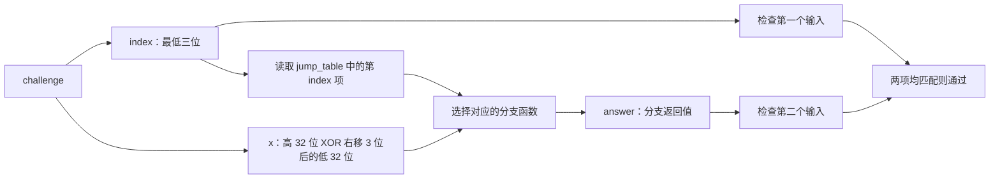

### 4. 通用求解实现

`solve_phase_3` 先计算 `index` 和 `x`，再严格按跳转表映射实现 `switch`：

```c
uint32_t index = (uint32_t)challenge & 7u;
uint32_t x =
    (uint32_t)(challenge >> 32) ^ (uint32_t)(challenge >> 3);
uint32_t answer = 0;

switch (index) {
case 0: answer = (4u * x) ^ 0x4e30u;          break;
case 1: answer = (x ^ 0xccc4u) + (x >> 1);    break;
case 2: answer = 5u * x + 0x100ccu;           break;
case 3: answer = (x ^ 0x7334u) + (x >> 2);    break;
case 4: answer = 5u * x + 0x5bb9u;            break;
case 5: answer = 3u * x + 0xa259u;            break;
case 6: answer = (2u * x) ^ 0x862fu;          break;
case 7: answer = 5u * x + 0x3d91eu;           break;
}

values[0] = index;
values[1] = answer;
count = 2;
```

`index` 的范围已限制为 0～7，八个分支覆盖了全部可能值。每个分支使用无符号 32 位运算复现对应指令，随后通过 `write_answer` 输出两项。

### 5. 运行验证与问题排查

使用 seed `42` 时，中间值为：

| 项目 | 值 |
| --- | --- |
| challenge | `0x581ce1ff0e4ae394` |
| index | `4` |
| challenge 高 32 位 | `0x581ce1ff` |
| challenge 右移 3 位后的低 32 位 | `0xe1c95c72` |
| x | `0xb9d5bd8d` |
| 分支 | `p3_case_6` |
| answer（保留低 32 位） | `0xa12d0f7a`，十进制为 `2704084858` |

手工输入 `4 2704084858`，得到 `Phase 3 defused.`：

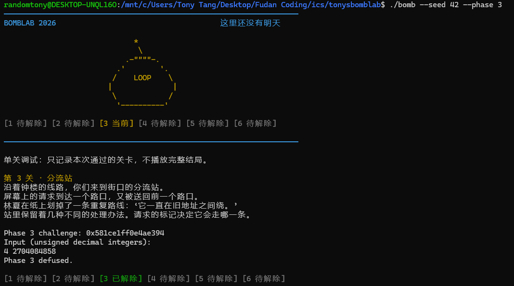

填入求解器后，第一次直接执行 `./defuser --seed 314159 --phase 3` 出现 `Phase 3 solver is incomplete or failed.`。检查发现源码已经设置 `count = 2`，但可执行文件的修改时间早于源码，运行的是旧版程序。执行 `make` 重新编译后，同一 seed 成功通过。这说明保存源码后还需要重新编译，才能验证本次修改。

另外使用截图中的非公开 seed `25180642` 验证，结果如下：

```text
$ ./defuser --seed 25180642 --phase 3
6 2325270655
$ ./defuser --seed 25180642 --phase 3 | ./bomb --seed 25180642 --phase 3
Phase 3 challenge: 0xc13be55023be73c6
Input (unsigned decimal integers):
Phase 3 defused.
```

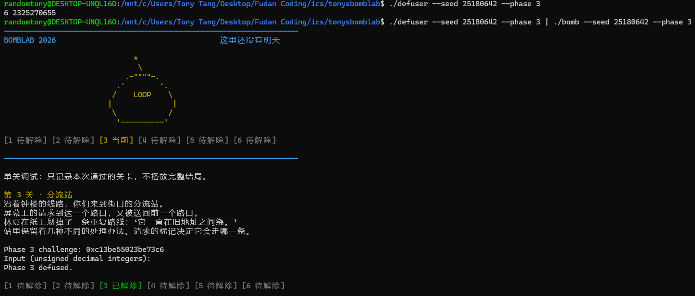

该 seed 不在 `tests/public.json` 的公开列表中，索引为 6，对应 `p3_case_0`，与 seed 42 所走的分支不同。重新编译后还执行了第三关的公开测试，十个 seed（`0`、`1`、`7`、`42`、`99`、`123`、`2026`、`65535`、`987654321`、`18446744073709551615`）均为 PASS：

```text
$ python3 public_test.py --phase 3
Public tests: 10/10
```

以上仅摘录公开测试的汇总行。10/10 表示十个用例通过，不能据此断言八个分支均被覆盖；通用性的分析依据还包括完整跳转表映射和各分支的位宽、运算顺序核对。

## 第 4 关：递归调用与返回过程

### 1. 输入格式与递归参数

第四关检查一个无符号 32 位整数是否等于 `p4_walk` 的返回值。`phase_04` 调用 `valid_u32_fields` 前将数量参数设为 1，并在调用 `sscanf` 后检查成功赋值数是否为 1；解析结果存放在 `rbp-0x14`。随后准备递归函数的四个参数：

```asm
402378: mov    %r12,%rcx
40237b: mov    %r12,%rax
40237e: mov    %r12d,%edi
402381: xor    %esi,%esi
402383: shr    $0x20,%rax
402387: shr    $0x7,%rcx
40238b: and    $0x7f,%edi
40238e: mov    $0x7f,%edx
402393: xor    %eax,%ecx
402395: call   <p4_walk>
40239a: cmp    %eax,-0x14(%rbp)
40239d: sete   %al
```

`r12` 保存 `challenge`。按整数参数的传递顺序，四个参数为：

| 参数寄存器 | 含义 | 初始值 |
| --- | --- | --- |
| `edi` | 目标 `target` | `(uint32_t)challenge & 0x7fu` |
| `esi` | 区间下界 `low` | `0` |
| `edx` | 区间上界 `high` | `127` |
| `ecx` | 混合值 `key` | `(uint32_t)(challenge >> 7) ^ (uint32_t)(challenge >> 32)` |

因此期望答案是 `p4_walk(target, 0, 127, key)`。`target` 必定落在初始区间内；`key` 在各层递归中保持不变。

### 2. 中点计算与终止条件

`p4_walk` 先将 `target` 暂存到 `eax`，再用 `edi` 计算中点：

```asm
4022c4: mov    %edi,%eax
4022c6: mov    %edx,%edi
4022c8: sub    %esi,%edi
4022ca: shr    $1,%edi
4022cc: add    %esi,%edi
4022ce: cmp    %eax,%edi
4022d0: je     402320
```

这对应 `mid = low + ((high - low) >> 1)`。如果目标等于中点，跳到终止分支：

```asm
402320: lea    0x12(%rdi),%eax
402323: xor    %ecx,%eax
402325: ret
```

`0x12` 为十进制 18，所以该层直接返回 `(mid + 18u) ^ key`，不再递归。

### 3. 左右分支与返回值组合

未命中时，程序先保存本层需要的 `mid + key`，然后比较目标和中点：

```asm
4022d6: push   %rbx
4022d7: lea    (%rdi,%rcx,1),%ebx
...
4022de: cmp    %edi,%eax
4022e0: jb     402300
```

`jb` 表示无符号小于，因此 `target < mid` 时向左递归，否则向右递归。相等的情况已在前面处理。两条路径的参数变化与返回运算如下：

| 条件 | 下一层调用 | 本层返回值，`child` 为下一层返回值 |
| --- | --- | --- |
| `target < mid` | `p4_walk(target, low, mid-1, key)` | `(5u * child) ^ (mid + key) ^ 3u` |
| `target > mid` | `p4_walk(target, mid+1, high, key)` | `(5u * child) ^ (mid + key) ^ 11u` |

以向左递归为例，关键指令为：

```asm
402300: lea    -0x1(%rdi),%edx
402303: mov    %eax,%edi
402305: call   <p4_walk>
40230a: lea    (%rax,%rax,4),%eax
40230d: xor    %ebx,%eax
40230f: mov    -0x8(%rbp),%rbx
402313: leave
402314: xor    $0x3,%eax
402317: ret
```

前两条指令将上界改为 `mid-1`，并把暂存的目标放回第一个参数寄存器。递归返回后，`eax` 是子调用的结果，`lea` 将其乘以 5，再与本层保存的 `mid + key`、常量 3 异或。向右分支则通过 `lea 0x1(%rdi),%esi` 更新下界，并将末尾异或常量改为 `0xb`（11）。

`rbx` 是被调用者保存寄存器：每个非终止调用都会先保存调用者的 `rbx`，使用 `ebx` 暂存自己的 `mid + key`，返回前恢复调用者的值。因此递归返回时，每一层都能取得属于自己的混合项。`ecx` 中的 `key` 在该函数内没有被改写。

整个计算分为两个方向：向下时根据目标缩小区间，向上时依次将子调用的返回值乘以 5，并异或本层数据。返回阶段必须按调用的逆序处理。

### 4. 通用求解实现与终止性

在 `defuser.c` 中添加辅助函数，保留与汇编一致的递归结构：

```c
static uint32_t phase4_walk(uint32_t target, uint32_t low,
                            uint32_t high, uint32_t key) {
    uint32_t mid = low + ((high - low) >> 1);

    if (target == mid) {
        return (mid + 18u) ^ key;
    }
    if (target < mid) {
        uint32_t child = phase4_walk(target, low, mid - 1u, key);
        return (5u * child) ^ (mid + key) ^ 3u;
    }
    uint32_t child = phase4_walk(target, mid + 1u, high, key);
    return (5u * child) ^ (mid + key) ^ 11u;
}
```

`solve_phase_4` 中的核心计算为：

```c
uint32_t target = (uint32_t)challenge & 0x7fu;
uint32_t key =
    (uint32_t)(challenge >> 7) ^ (uint32_t)(challenge >> 32);

values[0] = phase4_walk(target, 0u, 127u, key);
count = 1;
```

初始区间包含 `target`，每次未命中后选择的子区间仍包含目标，且长度严格减小。因此递归最终必定命中中点，不会进入空区间。在有效调用中，左分支满足 `mid > target >= 0`，所以 `mid-1` 不会发生无符号下溢；右分支同样不会越过有效上界。中点、混合项及返回值使用 `uint32_t`，乘法和加法的回绕与汇编中的 32 位结果一致。

### 5. 递归展开与运行验证

使用 seed `42` 时：

```text
challenge = 0x09bc585a244823f2
target    = 114
key       = 0xbdf4c81d
```

下表从上到下表示递归调用顺序；返回值则从最后一行开始向上计算：

| 层数 | 本层区间 | 中点 | 向下选择 | 本层最终返回值 |
| --- | --- | --- | --- | --- |
| 0 | `[0,127]` | 63 | 右 | `2200797203` |
| 1 | `[64,127]` | 95 | 右 | `1069878900` |
| 2 | `[96,127]` | 111 | 右 | `436860007` |
| 3 | `[112,127]` | 119 | 左 | `1422671712` |
| 4 | `[112,118]` | 115 | 左 | `2500551883` |
| 5 | `[112,114]` | 113 | 右 | `137568888` |
| 6 | `[114,114]` | 114 | 命中 | `3186935961` |

最深层返回 `(114 + 18) ^ key = 3186935961`。上一层中点为 113，走的是右分支，所以返回 `(5u * 3186935961u) ^ (113u + key) ^ 11u = 137568888`，其中乘法保留低 32 位。继续逐层回传，最外层得到 `2200797203`。

手工输入该整数后，第四关成功解除：

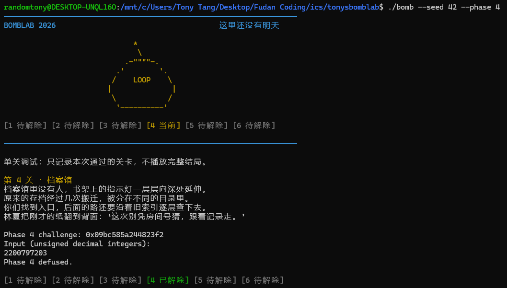

将通用递归公式写入求解器后，使用公开列表之外的 seed `25180642` 验证。截图中的命令和结果为：

```text
$ ./defuser --seed 25180642 --phase 4 | ./bomb --seed 25180642 --phase 4
Phase 4 challenge: 0xdcc6a1f83d082634
Input (unsigned decimal integers):
Phase 4 defused.
```

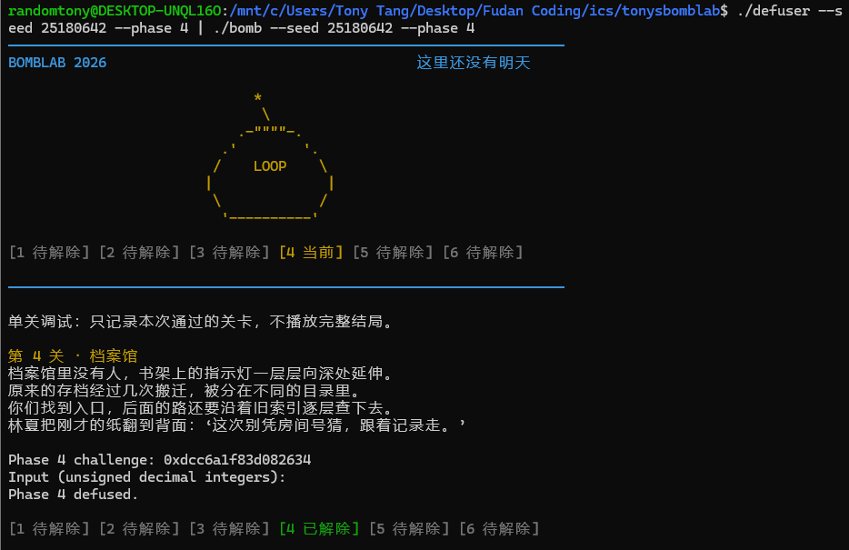

另执行第四关的公开测试，结果如下：

```text
$ python3 public_test.py --phase 4
Phase 4 seed 0: PASS
Phase 4 seed 1: PASS
Phase 4 seed 7: PASS
Phase 4 seed 42: PASS
Phase 4 seed 99: PASS
Phase 4 seed 123: PASS
Phase 4 seed 2026: PASS
Phase 4 seed 65535: PASS
Phase 4 seed 987654321: PASS
Phase 4 seed 18446744073709551615: PASS
Public tests: 10/10
```

这些记录验证了多个实际输入下的实现。通用性的依据是参数提取、终止条件、左右区间更新和返回值组合均与汇编一致，以及区间始终包含目标的递归不变量。

## 第 5 关：结构体布局与链表遍历

### 1. 输入格式与两个输出的来源

第五关要求输入两个无符号 32 位整数。`phase_05` 的格式检查数量为 2，且要求 `sscanf` 成功赋值两次。随后调用 `p5_traverse`：

```asm
40246c: lea    -0x14(%rbp),%rsi
402470: mov    %r12,%rdi
402473: call   <p5_traverse>
402478: mov    %eax,%edx
40247a: xor    %eax,%eax
40247c: cmp    %edx,-0x1c(%rbp)
40247f: jne    <phase_05+0x25>
402481: mov    -0x14(%rbp),%eax
402484: cmp    %eax,-0x18(%rbp)
402487: sete   %al
```

`rdi` 传入 `challenge`，`rsi` 指向存放另一个输出的栈空间。第一个输入与 `p5_traverse` 的返回值比较，第二个输入与该函数通过指针写出的值比较。因此需要同时恢复累积计算结果和指针输出的含义。

### 2. 恢复结构体布局和链表连接

遍历函数通过以下指令访问节点：

```asm
mov    (%rdx),%rdx
mov    0x8(%rdx),%esi
add    0xc(%rdx),%eax
```

偏移 0 处读取 8 字节地址作为下一个节点；偏移 8 和 12 处分别读取 4 字节整数。根据后续用途，将两个整数命名为 `id` 和 `weight`，可用以下结构描述节点：

```c
struct Node {
    const struct Node *next;  // 偏移 0，8 字节
    uint32_t id;              // 偏移 8，4 字节
    uint32_t weight;          // 偏移 12，4 字节
};
```

这些字段名是根据行为恢复的名称。入口通过指针表选取起始节点：

```asm
4023bd: and    $0x7,%eax
4023c4: mov    0x405b20(,%rax,8),%rdx
```

读取 `0x405b20` 开始的八个 8 字节表项，并按小端序解释，得到：

| 起点索引 | 节点地址 |
| --- | --- |
| 0 | `0x405b60` |
| 1 | `0x405b90` |
| 2 | `0x405bf0` |
| 3 | `0x405be0` |
| 4 | `0x405b80` |
| 5 | `0x405bb0` |
| 6 | `0x405bc0` |
| 7 | `0x405c00` |

再读取各节点的 `next` 指针，按实际连接关系整理如下；每行的下一节点为下一行，最后一行的 `next` 为 NULL：

| 链中位置 | 节点地址 | id | weight |
| --- | --- | --- | --- |
| 0 | `0x405b60` | `0x064e` | `0xba9d` |
| 1 | `0x405b90` | `0x074a` | `0x11c7` |
| 2 | `0x405bf0` | `0x0915` | `0xe729` |
| 3 | `0x405be0` | `0x0011` | `0x4729` |
| 4 | `0x405b80` | `0x0887` | `0x10ed` |
| 5 | `0x405bb0` | `0x0279` | `0xe585` |
| 6 | `0x405bc0` | `0x0a30` | `0xb677` |
| 7 | `0x405c00` | `0x0b25` | `0x9ab6` |
| 8 | `0x405c10` | `0x046a` | `0xd934` |
| 9 | `0x405ba0` | `0x031b` | `0x4fc8` |
| 10 | `0x405b70` | `0x0552` | `0xf847` |
| 11 | `0x405bd0` | `0x011d` | `0x4001` |

例如 `0x405b60` 处的 16 字节为 `90 5b 40 00 00 00 00 00 4e 06 00 00 9d ba 00 00`，分别对应 `next = 0x405b90`、`id = 0x064e`、`weight = 0xba9d`。由此可见，节点的地址排列顺序不等于链表遍历顺序，必须沿指针确定连接关系。

### 3. 提取参数并恢复遍历次数

`p5_traverse` 从 `challenge` 提取起点、移动次数和初始累积值：

```c
uint32_t start = (uint32_t)challenge & 7u;
uint32_t hops = (uint32_t)(challenge >> 3) & 3u;
uint32_t acc =
    (uint32_t)(challenge >> 6) ^
    (uint32_t)(challenge >> 32) ^ 0x2c37u;
```

起始节点在进入循环前就会被处理：

```asm
4023d9: mov    0x8(%rdx),%esi
...
4023de: xor    $0x2c37,%eax
4023e3: add    0xc(%rdx),%eax
4023e6: lea    (%rax,%rax,4),%eax
4023e9: mov    %esi,(%r8)
4023ec: xor    %esi,%eax
4023ee: and    $0x3,%edi
4023f1: je     402410
```

这里 `r8` 保存输出指针，`eax` 是累积值。每处理一个节点，先加 `weight`，再乘以 5，最后异或 `id`；同时将输出指针指向的整数更新为该节点的 `id`。因此统一的更新关系是：

```c
acc = (5u * (acc + node->weight)) ^ node->id;
last_id = node->id;
```

若 `hops` 为 0，处理起始节点后直接返回。否则循环沿 `next` 移动：

```asm
4023f3: mov    $0x1,%ecx
4023f8: mov    (%rdx),%rdx
4023fb: add    $0x1,%ecx
4023fe: mov    0x8(%rdx),%esi
402401: add    0xc(%rdx),%eax
402404: lea    (%rax,%rax,4),%eax
402407: mov    %esi,(%r8)
40240a: xor    %esi,%eax
40240c: cmp    %ecx,%edi
40240e: jae    4023f8
```

循环计数器从 1 开始，每轮移动一次后加 1，再判断 `hops >= ecx` 是否继续。`hops` 为 1 时循环执行一轮，为 2、3 时分别执行两轮、三轮。因此实际访问节点数是 `hops + 1`，最后输出的是位置 `start + hops` 的节点标识。这里的标识来自节点字段，不是节点在表中的下标。

### 4. 通用实现与数组表示的依据

起点表的八个地址恰好对应上述链表的前八个位置。将节点字段按链表顺序保存到数组后，沿 `next` 移动一次就等价于数组下标加 1。求解器采用如下常量表：

```c
static const uint32_t ids[] = {
    0x064eu, 0x074au, 0x0915u, 0x0011u,
    0x0887u, 0x0279u, 0x0a30u, 0x0b25u,
    0x046au, 0x031bu, 0x0552u, 0x011du
};
static const uint32_t weights[] = {
    0xba9du, 0x11c7u, 0xe729u, 0x4729u,
    0x10edu, 0xe585u, 0xb677u, 0x9ab6u,
    0xd934u, 0x4fc8u, 0xf847u, 0x4001u
};
```

计算好 `start`、`hops` 和初始 `acc` 后，执行：

```c
for (uint32_t i = 0; i <= hops; ++i) {
    uint32_t pos = start + i;
    acc = (5u * (acc + weights[pos])) ^ ids[pos];
}
values[0] = acc;
values[1] = ids[start + hops];
count = 2;
```

`i <= hops` 保证起点也参与运算。由于 `start <= 7`、`hops <= 3`，访问的最大数组下标为 10，不会越界或访问空指针；位置 11 的节点虽已从炸弹中恢复，但不会在本关的有效参数范围内被访问。节点常量来自个人炸弹的固定数据，起点、访问次数和累积结果仍随 `challenge` 改变。每一步使用 `uint32_t`，保持原程序加法、乘法和异或的顺序及位宽。

### 5. 运行验证

使用 seed `42` 时，`challenge = 0xde4431fa3c80db06`，得到 `start = 6`、`hops = 0`，初始累积值为 `917905057`。只处理 `0x405bc0` 节点，其 `id = 2608`、`weight = 46711`：

```text
加 weight：917905057 + 46711 = 917951768
乘以 5：4589758840，保留低 32 位后为 294791544
异或 id：294791544 XOR 2608 = 294789960
口令：294789960 2608
```

手工输入后显示 `Phase 5 defused.`：

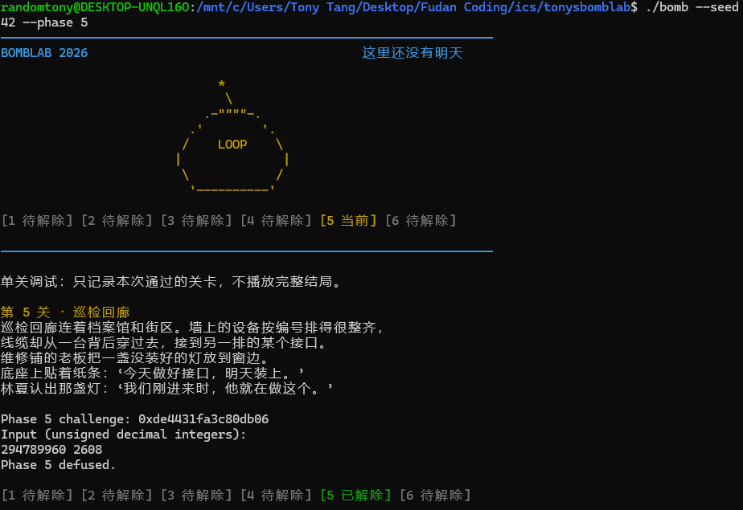

这个 seed 没有进入沿指针移动的循环，因此进一步使用非公开 seed `25180642` 验证。此时 `challenge = 0xb7e2acdb1ae83817`，`start = 7`、`hops = 2`，共访问三个节点：

| 访问次序 | 节点地址 | id | 处理后的 acc |
| --- | --- | --- | --- |
| 起始节点 | `0x405c00` | 2853 | 1236315887 |
| 移动一次 | `0x405c10` | 1130 | 1886891205 |
| 移动两次 | `0x405ba0` | 795 | 844623322 |

```text
$ ./defuser --seed 25180642 --phase 5
844623322 795
$ ./defuser --seed 25180642 --phase 5 | ./bomb --seed 25180642 --phase 5
Phase 5 challenge: 0xb7e2acdb1ae83817
Input (unsigned decimal integers):
Phase 5 defused.
```

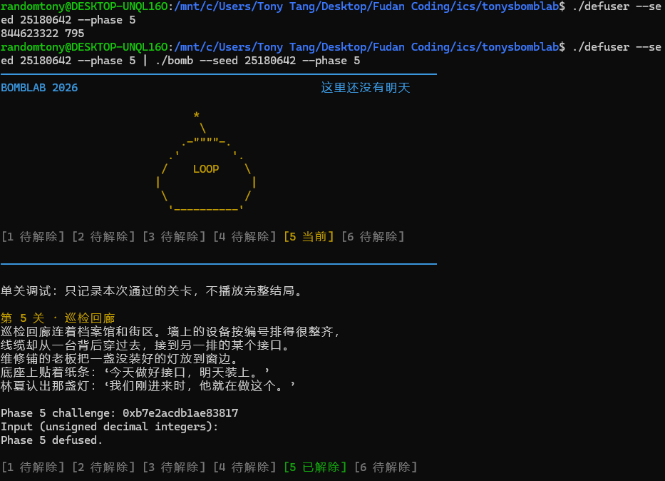

此外运行第五关公开测试，十个用例均通过：

```text
$ python3 public_test.py --phase 5
Phase 5 seed 0: PASS
Phase 5 seed 1: PASS
Phase 5 seed 7: PASS
Phase 5 seed 42: PASS
Phase 5 seed 99: PASS
Phase 5 seed 123: PASS
Phase 5 seed 2026: PASS
Phase 5 seed 65535: PASS
Phase 5 seed 987654321: PASS
Phase 5 seed 18446744073709551615: PASS
Public tests: 10/10
```

两次截图分别验证了只处理起点和沿链表继续访问的情形。通用性的分析依据是完整恢复起点表与节点连接关系、准确确定 `hops + 1` 的处理次数，以及逐项复现 32 位运算。

## 第 6 关：函数指针表与间接调用

### 1. 输入格式与调用结构

第六关要求一个无符号 32 位整数。`phase_06` 的格式检查数量为 1，`sscanf` 必须成功赋值一次；随后将 `challenge` 传给 `p6_dispatch`，用返回值检查输入：

```asm
4025b8: mov    %r12,%rdi
4025bb: call   <p6_dispatch>
4025c0: cmp    %eax,-0x14(%rbp)
4025c3: sete   %al
```

与第三关按索引跳转到某个分支不同，本关通过函数指针表连续调用两个函数，第二次调用的参数由第一次返回值计算得到。`p6_dispatch` 的关键指令如下：

```asm
402529: mov    %rdi,%rbx
40252c: shr    $0x6,%rdi
402530: mov    %rbx,%rax
402533: shr    $0x20,%rax
402537: xor    %eax,%edi
402539: mov    %rbx,%rax
402540: and    $0x38,%ebx
402543: and    $0x7,%eax
402546: call   *0x405dc0(,%rax,8)
40254d: xor    $0xd429,%eax
402552: mov    %eax,%edi
402554: call   *0x405dc0(%rbx)
...
40255f: add    $0xc54d,%eax
```

可恢复出两个索引和第一次调用的输入：

```c
uint32_t first = (uint32_t)challenge & 7u;
uint32_t second = (uint32_t)(challenge >> 3) & 7u;
uint32_t x =
    (uint32_t)(challenge >> 6) ^ (uint32_t)(challenge >> 32);
```

第一次调用按 `first * 8` 取表项。第二次调用使用的 `rbx` 已经是字节偏移：`challenge & 0x38` 等于 `second * 8`，不需要再乘以 8。`rbx` 属于被调用者保存寄存器，第一次函数调用后仍保留这个偏移。

### 2. 恢复函数指针表

从 `0x405dc0` 读取八个 8 字节指针，并结合目标地址的反汇编，得到如下映射。`v` 表示该次调用传入的 `uint32_t` 参数：

| 表索引 | 函数地址 | 实际函数 | 返回值 |
| --- | --- | --- | --- |
| 0 | `0x402490` | `p6_op_0` | `(v ^ (v >> 2)) + 0x9024u` |
| 1 | `0x402500` | `p6_op_4` | `ROL32(v, 7) ^ 0x8191u` |
| 2 | `0x402500` | `p6_op_4` | `ROL32(v, 7) ^ 0x8191u` |
| 3 | `0x402490` | `p6_op_0` | `(v ^ (v >> 2)) + 0x9024u` |
| 4 | `0x4024b0` | `p6_op_1` | `(v ^ 0x53c4u) + (v << 7)` |
| 5 | `0x402510` | `p6_op_5` | `(v + 0x4e78u) ^ (v >> 5)` |
| 6 | `0x4024e0` | `p6_op_3` | `(2u * v + 0x5732u) ^ (7u * v)` |
| 7 | `0x4024d0` | `p6_op_2` | `ROR32(v, 5)` |

其中 `ROL32`、`ROR32` 分别表示 32 位循环左移、循环右移。八个表项包含重复地址，因此只有六种不同操作；索引与函数名后缀并不一一对应。

### 3. 位运算和返回值组合

循环移位与普通移位的区别是，移出一端的位会重新进入另一端。例如：

```asm
# p6_op_4
402504: mov    %edi,%eax
402506: rol    $0x7,%eax
402509: xor    $0x8191,%eax

# p6_op_2
4024d4: mov    %edi,%eax
4024d6: ror    $0x5,%eax
```

在 `uint32_t v` 上，左旋 7 位可写为 `(v << 7) | (v >> 25)`，右旋 5 位可写为 `(v >> 5) | (v << 27)`。两部分位段互补，通过按位或拼接，保留循环移出的位；这里的移位量均在 1～31 范围内。

乘加和异或也需要保持指令顺序。例如 `p6_op_3`：

```asm
4024e4: lea    0x0(,%rdi,8),%edx
4024eb: lea    0x5732(%rdi,%rdi,1),%eax
4024f2: sub    %edi,%edx
4024f4: xor    %edx,%eax
```

`edx` 先得到 `8*v`，再减去 `v`，成为 `7*v`；`eax` 得到 `2*v + 0x5732`，最后将二者异或。因此该函数对应 `(2u*v + 0x5732u) ^ (7u*v)`。

设 `F[k]` 为指针表第 `k` 项对应的操作，整个调度过程为：

```text
x ── F[first] ──→ a ── XOR 0xd429 ──→ b ── F[second] ──→ d ── +0xc54d ──→ answer
```

两条 `call *...` 都是间接调用：目标地址从表项读取，调用结束后返回到后续指令，整数返回值位于 `eax`。第一次结果异或常量后，通过 `mov %eax,%edi` 作为第二次调用的参数。第二次返回后才加 `0xc54d`。这些步骤的位置和先后顺序不能交换。

### 4. 通用求解实现

在 `defuser.c` 中用辅助函数复现表索引对应的操作：

```c
static uint32_t phase6_apply(uint32_t index, uint32_t v) {
    switch (index) {
    case 0:
    case 3:
        return (v ^ (v >> 2)) + 0x9024u;
    case 1:
    case 2:
        return ((v << 7) | (v >> 25)) ^ 0x8191u;
    case 4:
        return (v ^ 0x53c4u) + (v << 7);
    case 5:
        return (v + 0x4e78u) ^ (v >> 5);
    case 6:
        return (2u * v + 0x5732u) ^ (7u * v);
    case 7:
        return (v >> 5) | (v << 27);
    }
    return 0;
}
```

`solve_phase_6` 提取 `first`、`second` 和 `x` 后，按顺序完成两次调用：

```c
uint32_t a = phase6_apply(first, x);
uint32_t b = a ^ 0xd429u;
uint32_t d = phase6_apply(second, b);

values[0] = d + 0xc54du;
count = 1;
```

两个索引均被限制在 0～7，辅助函数的八个分支覆盖全部可能值。全部中间值使用 `uint32_t`，加法、乘法和左移保留 32 位结果；右移则为逻辑右移，与目标汇编一致。

### 5. 运行验证

使用 seed `42` 时，`challenge = 0x37e9671c45376d5d`。第一次索引为 5，第二次索引为 3，依次调用 `p6_op_5` 和 `p6_op_0`：

| 步骤 | 计算关系 | 结果 |
| --- | --- | --- |
| 初始输入 | challenge 右移 6 位的低 32 位 XOR 高 32 位 | `x = 0x46fdbaa9` |
| 第一次调用 | `(x + 0x4e78u) ^ (x >> 5)` | `a = 0x44c9e4f4` |
| 两次调用之间 | `a ^ 0xd429u` | `b = 0x44c930dd` |
| 第二次调用 | `(b ^ (b >> 2)) + 0x9024u` | `d = 0x55fc0d0e` |
| 最终输出 | `d + 0xc54du` | `0x55fcd25b`，即 `1442632283` |

手工输入 `1442632283` 后，程序显示 `Phase 6 defused.`：

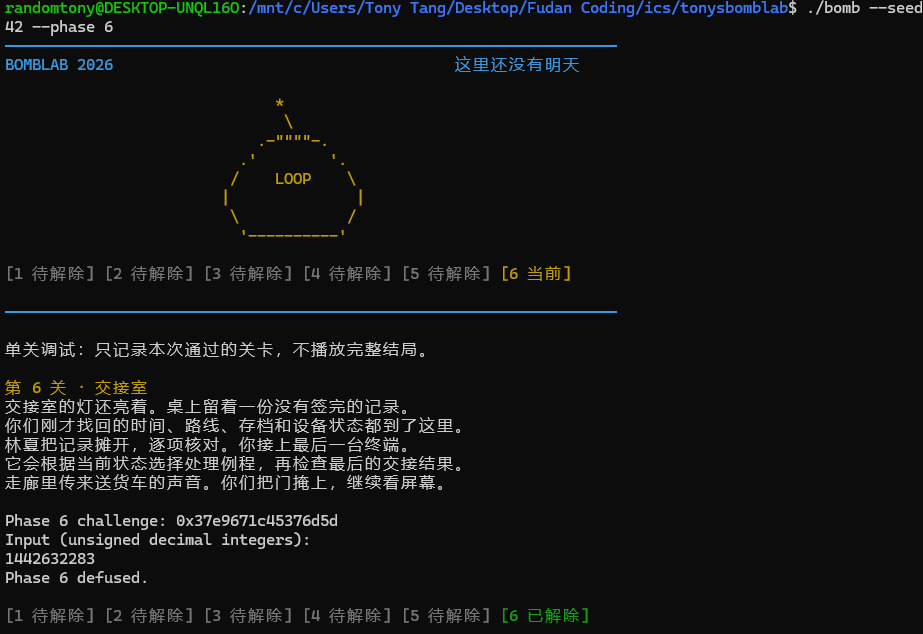

另使用公开列表之外的 seed `25180642` 验证通用实现，截图记录如下：

```text
$ ./defuser --seed 25180642 --phase 6
1768668962
$ ./defuser --seed 25180642 --phase 6 | ./bomb --seed 25180642 --phase 6
Phase 6 challenge: 0x797e0a638e930d77
Input (unsigned decimal integers):
Phase 6 defused.
```

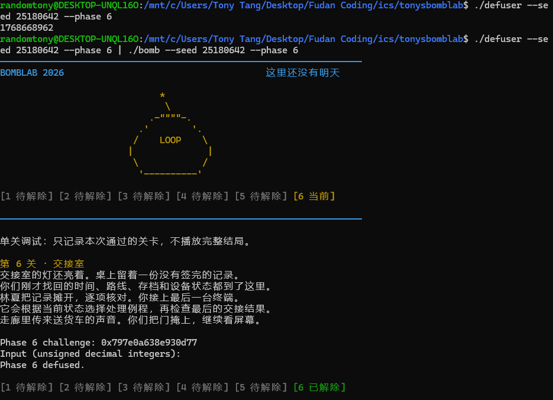

这次 `first = 7`、`second = 6`，依次执行右旋 5 位和乘加异或操作，补充验证了 seed 42 未执行的循环右移分支。两次截图并不覆盖所有表项；完整实现还需依据指针表逐项核对，尤其不能将左旋、右旋替换为普通移位。

## 隐藏关：输入布局与上下文相关校验

### 1. 调用入口与 context 的来源

隐藏关的求解接口为 `solve_secret(challenge, context, out, cap)`。阅读 `defuser_main.c` 可见，驱动先计算六个常规关卡的答案，再调用 `transcript_context(lines)` 生成 `context`，将其与第七关的 `challenge` 一同传入求解函数。

`challenge.c` 中的 `transcript_context` 按关卡顺序解析答案中的十进制整数，将整数值、关卡编号和字段下标依次混合。因此隐藏关与前六关答案相关；求解时直接使用驱动传入的 `context`，不需要修改驱动或重新实现这一过程。`./defuser --secret` 只输出第七行，验证时还需要先向同一次炸弹运行提供前六行答案。

隐藏关检查分为两层：`secret_gate` 检查整行长度和固定位置的标志，随后 `secret_phase` 检查标志后面的三个整数。

### 2. 从地址差恢复第七行布局

`secret_gate` 将输入复制到栈上，关键指令为：

```asm
4026eb: lea    -0xd0(%rbp),%r12
...
40270c: call   <strlen@plt>
402711: sub    $0x24,%rax
402715: cmp    $0x7f,%rax
402719: jbe    402730
...
402730: mov    %rbx,%rsi
402733: mov    %r12,%rdi
402736: call   <secret_copy>
40273b: cmpl   $0x4e45504f,-0xb0(%rbp)
402745: jne    <secret_gate+0x4b>
402747: mov    %r14,%rdx
40274a: mov    %r13,%rsi
40274d: lea    -0xac(%rbp),%rdi
402754: call   <secret_phase>
```

长度检查使用无符号比较：`strlen(input) - 36 <= 127`，因此允许的长度为 36～163 字节，不含结尾的 NUL。小于 36 时减法发生无符号回绕，不能通过检查。

复制起点为 `rbp-0xd0`，标志位于 `rbp-0xb0`，二者相差 32 字节；传给 `secret_phase` 的字符串从 `rbp-0xac` 开始，距复制起点 36 字节。常量 `0x4e45504f` 按小端序存储为 `4f 50 45 4e`，对应 ASCII 字符 `OPEN`。因此输入布局为：

| 从输入起点计算的偏移 | 内容 | 用途 |
| --- | --- | --- |
| 0～31 | 32 个 ASCII 字符 A | 填充到标志位置 |
| 32～35 | `OPEN` | 满足固定位置的四字节检查 |
| 36 起 | 三个空格分隔的十进制整数 | 由 `secret_phase` 解析 |
| 字符串末尾 | NUL | 结束字符串，不计入 `strlen` |

`secret_copy` 的复制循环如下：

```asm
4026c0: movzbl (%rsi,%rax,1),%edx
4026c4: mov    %dl,(%rdi,%rax,1)
4026c7: add    $0x1,%rax
4026cb: test   %dl,%dl
4026cd: jne    4026c0
```

它从偏移 0 开始逐字节复制，读到 NUL 后将其写入目标再退出。因此前缀中不能有提前终止字符串的 NUL。采用固定 32 个单字节字符 A，可以准确控制 `OPEN` 的偏移。数字直接接在 `OPEN` 后，`secret_phase` 从该处接收字符串，故数字解析不包含前缀。

### 3. 恢复三个整数的关系

进入 `secret_phase` 时，`rsi` 为 `challenge`，`rdx` 为 `context`，分别被保存到 `r12` 和 `r13`。函数先调用 `valid_u32_fields` 检查恰有三个整数，再要求 `sscanf` 成功赋值三次。三个结果分别存放在 `rbp-0x2c`、`rbp-0x28`、`rbp-0x24`。

第一个整数的检查为：

```asm
402650: mov    %r13d,%ecx
402655: and    $0x3,%ecx
402658: cmp    %ecx,-0x2c(%rbp)
```

因此 `first = (uint32_t)context & 3u`。后续计算先将两个 64 位参数分别折叠为 32 位，记为 `c`、`t`：

```c
uint32_t c = (uint32_t)challenge ^ (uint32_t)(challenge >> 32);
uint32_t t = (uint32_t)context ^ (uint32_t)(context >> 32);
```

汇编将 `c ^ t` 放入 `edi` 后调用 `secret_mix`。该辅助函数的全部运算为：

```asm
4025d4: mov    %edi,%eax
4025d6: rol    $1,%eax
4025d8: add    $0x6941,%eax
4025dd: xor    $0x6b5,%eax
```

设 `v = c ^ t`，则其返回值为 `mixed = (ROL32(v, 1) + 0x6941u) ^ 0x6b5u`，其中 `ROL32(v, 1)` 用 `(v << 1) | (v >> 31)` 实现。

调用者还计算并保存了一个混合项：

```asm
402660: imul   $0x6941,%ecx,%r9d
...
402678: shr    $0x10,%r13
40267e: xor    %r13d,%r9d
...
402684: call   <secret_mix>
402689: xor    %r9d,%eax
40268c: cmp    %eax,-0x28(%rbp)
```

检查 `secret_mix` 的函数体可见，它没有改写 `r9d`，故调用后该寄存器仍保存混合项。这里的判断依据是实际指令，不能仅凭调用约定假定 `r9` 会跨调用保留。第二个整数为：

```c
uint32_t second = mixed ^ (first * 0x6941u)
                        ^ (uint32_t)(context >> 16);
```

这里右移 16 位后再转为 32 位，取得原 `context` 的第 16～47 位。第三个整数继续使用第二个结果计算：

```asm
402691: shr    $1,%esi
402693: lea    0x6b5(%r8,%rcx,1),%edx
40269b: add    %esi,%edx
40269d: xor    %edx,%eax
40269f: cmp    -0x24(%rbp),%eax
```

此时 `esi` 原为 `c`，`r8d` 为 `t`，`ecx` 为 `first`，`eax` 为 `second`。因此：

```c
uint32_t third = second ^ (t + first + 0x6b5u + (c >> 1));
```

三个值的依赖关系可以概括为：先从 `context` 取 `first`，再将 `challenge` 与 `context` 混合得到 `second`，最后由 `second` 和两者的折叠值计算 `third`。所有乘加、移位和异或均保持汇编中的 32 位结果。

### 4. 通用实现与输出长度

在 `solve_secret` 中先计算三个整数，再将固定前缀与数字一起写入 `out`：

```c
uint32_t c = (uint32_t)challenge ^ (uint32_t)(challenge >> 32);
uint32_t t = (uint32_t)context ^ (uint32_t)(context >> 32);
uint32_t first = (uint32_t)context & 3u;
uint32_t v = c ^ t;
uint32_t rotated = (v << 1) | (v >> 31);
uint32_t mixed = (rotated + 0x6941u) ^ 0x6b5u;
uint32_t second = mixed ^ (first * 0x6941u)
                        ^ (uint32_t)(context >> 16);
uint32_t third = second ^ (t + first + 0x6b5u + (c >> 1));

int size = snprintf(
    out, cap,
    "AAAAAAAA" "AAAAAAAA" "AAAAAAAA" "AAAAAAAA"
    "OPEN"
    "%" PRIu32 " %" PRIu32 " %" PRIu32,
    first, second, third
);
if (size < 0 || (size_t)size >= cap) {
    return 1;
}
return 0;
```

相邻字符串字面量在编译时拼接，四组各 8 个 A 恰好构成 32 字节填充。`first` 为 0～3，占一个十进制字符；另两个 `uint32_t` 各占 1～10 个字符，加两个空格后，整行长度为 41～59 字节，始终满足入口的 36～163 字节限制。`snprintf` 同时检查容量和字符串终止，不在 `out` 中写入换行；驱动负责输出行末换行。

### 5. 完整七行输入与运行验证

隐藏关验证需要同一次炸弹运行先通过六关。将六行常规答案和第七行按顺序写入管道：

```bash
make
{
    ./defuser --seed 42
    ./defuser --secret --seed 42
} | ./bomb --seed 42
```

保存的成功截图显示六关均已解除，且随后出现 `Secret phase defused.`：

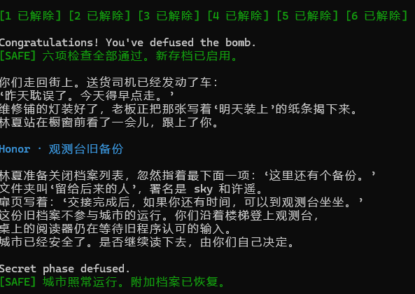

另外使用不在公开列表中的 seed `25180642` 验证，先查看求解器生成的第七行：

```text
$ ./defuser --secret --seed 25180642
AAAAAAAAAAAAAAAAAAAAAAAAAAAAAAAAOPEN3 3147846098 384878379
```

再以相同 seed 提交完整七行：

```bash
{
    ./defuser --seed 25180642
    ./defuser --secret --seed 25180642
} | ./bomb --seed 25180642
```

实际运行中六个常规关卡依次通过，末尾输出如下（仅摘录最后两行）：

```text
Congratulations! You've defused the bomb.
Secret phase defused.
```

该验证同时检查了第七行布局、三个整数及其与前六关答案生成的 `context` 的一致性。两次运行均通过正常输入完成检查。

## 完整实验验证

### 1. 复现步骤

在 WSL 的项目根目录下，使用以下命令重新构建并执行完整公开测试：

```bash
make
python3 public_test.py
```

需要检查某个非公开 seed 时，可按各关“运行验证”中的命令执行。单关管道两端必须使用相同的 seed 和关卡编号；隐藏关则需要在同一次炸弹运行中依次提交六行常规口令和第七行。`--secret` 模式生成第七行时所用的 seed 也必须与前六关一致。

### 2. 验证结果汇总

六个常规关卡和隐藏关均实现后，执行完整公开测试。六关与隐藏关均全部通过，以下摘录六关汇总及隐藏关逐 seed 结果：

```text
$ python3 public_test.py
Public tests: 60/60
Secret seed 0: PASS
Secret seed 1: PASS
Secret seed 7: PASS
Secret seed 42: PASS
Secret seed 99: PASS
Secret seed 123: PASS
Secret seed 2026: PASS
Secret seed 65535: PASS
Secret seed 987654321: PASS
Secret seed 18446744073709551615: PASS
Secret public tests: 10/10 (optional)
```

各关截图和独立于公开列表的验证记录已放在对应章节，汇总如下：

| 验证对象 | 公开测试 | 公开列表之外的 seed | 对应验证重点 |
| --- | --- | --- | --- |
| Phase 1 | 10/10 | `314159` | 参数拆分与三个辅助函数的组合 |
| Phase 2 | 10/10 | `314159` | 首项计算及后续五项递推 |
| Phase 3 | 10/10 | `25180642` | 索引 6 对应的分支，与 seed 42 的索引 4 区分 |
| Phase 4 | 10/10 | `25180642` | 在另一组目标和 key 下检验递归计算 |
| Phase 5 | 10/10 | `25180642` | `hops = 2`，补充 seed 42 只处理起点的情形 |
| Phase 6 | 10/10 | `25180642` | 依次执行右旋和乘加异或，补充不同函数组合 |
| Secret phase | 10/10 | `25180642` | 固定偏移、整数关系与完整七行的 context 一致性 |

上述非公开 seed 均通过验证。“非公开”在此仅指不在 `tests/public.json` 的十个 seed 中，不代表已知课程评分时使用的私有测试。

### 3. 结论的适用范围

60/60 表示六个常规关卡各自的十个公开 seed 全部通过，隐藏关 10/10 表示十个公开 seed 下的完整七行输入均通过相应检查。这些测试不表示覆盖了所有可能的 `challenge` 或所有分支组合。通用性的依据是从个人炸弹恢复出的计算关系、位宽、控制流程及隐藏关输入布局，测试则用于检查这些关系的具体实现。

报告中的地址、常量和表项属于本次个人炸弹。当前求解器面向该炸弹的不同 `challenge`；若换用另一份个人炸弹，应重新确认这些静态信息，不能直接沿用本报告中的数值。

## 实验总结与反思

### 1. 从指令恢复程序结构

六个常规关卡逐步扩展了观察范围。第一关需要跟踪调用前后的寄存器值，第二关需要把连续访存和循环更新识别为数组递推；第三关以后，单看指令已不够，还要读取跳转表、节点和函数指针表。第四关尤其要求同时分析递归下降与返回展开，否则即使找到了目标位置，也不能得到最终返回值。隐藏关则把字节偏移、字符串解析和前六关的计算结果连接起来。

这些分析形成了一个共同方法：先明确当前值代表什么，再判断下一条指令如何改变它。例如，`lea` 可以用于整数乘加，链表地址的大小不代表节点先后，函数名末尾的编号也不代表表项索引。恢复高级语言结构时，每一步都需要指令或数据支持。

### 2. 实现中需要关注的边界

| 检查点 | 本实验中的具体处理 |
| --- | --- |
| 计算位宽 | 保留 64 位参数的移位顺序，在汇编产生 32 位结果的位置截断；用无符号类型表达回绕 |
| 分支映射 | Phase 3 与 Phase 6 分别依据实际表项恢复目标，并处理多个索引指向同一函数的情况 |
| 递归边界 | Phase 4 保持目标始终处于当前闭区间内，子区间严格缩小，直到命中中点 |
| 遍历边界 | Phase 5 处理起点及 `hops` 个后继，共 `hops + 1` 个节点；最大访问下标为 10 |
| 输出协议 | 常规关卡输出正确数量的十进制整数；隐藏关保证 `OPEN` 位于偏移 32，数字从偏移 36 开始 |
| 缓冲区与返回值 | 检查 `snprintf` 错误和截断；求解成功返回 0，由驱动输出换行 |

### 3. 调试与验证的收获

第三关曾出现源码已经补全、运行仍提示未完成的情况。确认可执行文件没有更新并重新编译后，问题得到解决。这一经历提醒我，分析源码、检查构建产物和观察运行结果需要连起来（形成行动SOP）：只看其中一项，容易把构建问题误判为公式错误。

另一个收获是主动选择能补充已有路径的输入。第五关的 seed 42 只处理起点，增加 `hops = 2` 的输入后，才能检查后继节点的连接；第六关增加不同索引组合，补充了右旋分支的验证。后续若继续提高验证强度，可以记录各 seed 对跳转表索引、递归边界及函数组合的覆盖情况；本报告未将这项进一步的覆盖统计计作已完成结果。

完成实验后，我对“程序正确”的理解更具体了：既要让结果通过检查，也要能够解释输入范围、每条执行路径和每次整数运算为何与目标程序一致。

## 故事赏析：保存今天，允许明天改变

### 1. 关卡结构与城市空间相互呼应

剧情把抽象的程序结构放进可行走的城市空间，使每一关都有一个容易记住的观察对象。以下对应是对叙事组织方式的理解，并不意味着关卡中的简短校验函数实际实现了整座城市的系统。

| 场景 | 叙事中的任务 | 与技术内容的呼应 |
| --- | --- | --- |
| 维护站 | 找回旧工具缺失后的合法口令 | 沿函数调用恢复计算过程，重新理解接口 |
| 钟楼 | 接起一串依赖前次结果的校时记录 | 数组递推中的前后依赖 |
| 分流站 | 根据请求标记选择正确路线 | 通过索引与跳转表确定分支 |
| 档案馆 | 沿旧索引深入并带回完整记录 | 递归下降，以及逐层返回和组合 |
| 巡检回廊 | 按线缆核对真实连接 | 沿指针遍历，区别物理排列与逻辑顺序 |
| 交接室 | 选择处理例程并完成最终检查 | 函数指针选择与返回值组合 |
| 观测台 | 在城市恢复后阅读旧备份 | 通过额外输入恢复与此前过程有关的档案 |

林夏说“跟着记录走”，既符合档案馆的情境，也可以作为本实验的分析原则：遇到间接关系时，沿着证据确定下一步。读者在故事里寻找路径，在汇编里追踪数据，两种阅读因此形成了呼应。

### 2. “明天”从一句承诺变成可以抵达的时间

故事最初用重复制造异常。司机说“明天一定送到”，维修铺的纸条写着“明天装上”，这些话原本属于平常生活，却因旧存档不断恢复而失去兑现的机会。档案馆揭示故障后，前面的细节获得了新的含义：居民持续劳动，每天的成果却在夜间消失。

因此，结局中“保存完成”的重量来自这些已经见过的小事。日期前进，灯装好了，司机开始新的行程，说明今天能够成为明天的基础。对读者而言，程序的状态保存也有了可感知的结果：一段努力可以留下来，一项计划终于能够接着做。

### 3. 维护是一种具体的关心

故事将注意力放在读日志、查索引、核对接口和确认保存这些细小动作上。两位来访者逐项接续前人留下的工作，维修铺老板反复摆弄自己的灯，sky 在结尾接手剩下的维护。城市的恢复由许多人的劳动共同完成。

灯和椅子使这种关心有了具体形状。维修铺的灯标记着尚未完成、终于完成的日常工作；观测台的灯和两把椅子，为暂时回来的人留出停歇之处；实验室里搭着外套的椅背，则把故事安稳地接回出发的夜晚。最终确认保存、合上电脑、关灯离开，让漫长排查有了平常而完整的收尾。

### 4. 隐藏关让“留下”具有更多含义

隐藏关开始前，文本明确交代城市已经安全，旧档案不参与运行，是否继续由来访者决定。这一安排让阅读往事带有自愿停留的意味。恢复城市运行之后，仍有人值得认识，也仍有故事值得保存。

sky 与许遥的留言尤其动人之处，在于他们给彼此保留了改变的余地。一个去北方，一个暂时留下；后来项目和工作都发生变化，联系也有间隔。他们仍允许对方回来添一点东西。许遥提醒 sky，遇到不喜欢的事可以说出来，这使曾经的选择保持开放，也让长久的联系容得下新的生活。

从这一角度看，主线和隐藏关可以放在一起理解：城市通过新存档积累变化，人也可以带着已经发生的经历继续尝试。保留下来的记录提供了出发的基础，而“下次回来，先坐一会儿”给未来留出了空间。结尾把一份久藏的项目介绍放进明天待办，便是这种理解落到生活中的一个小动作。

## 资料与工具使用说明

本节统一说明技术分析、运行验证及故事整理使用的资料和工具。

| 资料或工具                                                       | 用途                                                                      |
| ----------------------------------------------------------- | ----------------------------------------------------------------------- |
| [README.md](README.md)                                      | 核对求解接口、报告内容和验证要求                                                        |
| [tutor/README.md](tutor/README.md)                          | 参考参数传递、反汇编阅读及从汇编恢复通用求解式的方法                                              |
| [tests/public.json](tests/public.json)                      | 确认公开 seed 范围，并选择列表之外的 seed 验证                                           |
| [defuser_main.c](defuser_main.c)、[challenge.c](challenge.c) | 只读检查隐藏关调用方式及前六关答案如何生成 context                                           |
| [Makefile](Makefile)、[defuser.h](defuser.h)                 | 核对编译选项、求解接口及输出缓冲区约定                                                     |
| 个人 `bomb` 内嵌剧情文本                                            | 核对序章、六关过场、普通结局与观测台旧备份；作为故事梗概和文本引语的依据                                    |
| GNU `objdump`                                               | 只读查看个人炸弹的关卡、辅助函数、跳转表、链表节点及函数指针表数据                                       |
| WSL、`make` 与 GCC                                            | 编译 `defuser.c`；构建使用仓库既有的警告与错误检查选项                                       |
| 个人 `bomb` 与 `public_test.py`                                | 检查具体 seed 下的口令；公开测试结果按关卡记录                                              |
| PowerShell                                                  | 检查文件和截图引用，按 UTF-8 读取炸弹内嵌文本以核对故事内容                                       |
| Codex                                                       | 辅助解释汇编和寄存器数据流、辅助理解并核对计算关系、计算示例值、检查实现、执行编译及测试；辅助整理报告、绘制 Mermaid 图、讨论故事解读 |

汇编依据来自个人炸弹，验证记录来自实际运行或保存的终端截图。有限次测试用于发现实现错误；对通用计算关系的判断仍需结合指令、分支映射和整数位宽逐项理解与核对。

故事赏析中的象征联系属于文本解读，不据此推定作者的个人经历或未明示的人物关系。尾声短诗以顾城式的童话视角、短句和明暗意象为创作参照，并非顾城作品或诗句摘录。

## 尾声：明天的小船

> 钟楼养着一只圆  
> 每天  
> 都把它放回  
> 同一个夜晚
>
> 我们替小灯  
> 接好断开的根  
> 它开出一片街道  
> 让脚步从里面经过
>
> 雪落在很远的信上  
> 这里的两把椅子  
> 把一点暖  
> 留在中间
>
> 你有你的北方  
> 我有尚未长高的树  
> 风来时  
> 叶子会替我写信
>
> 临走  
> 我把明天折成小船  
> 放在桌上  
> 等清晨涨潮
